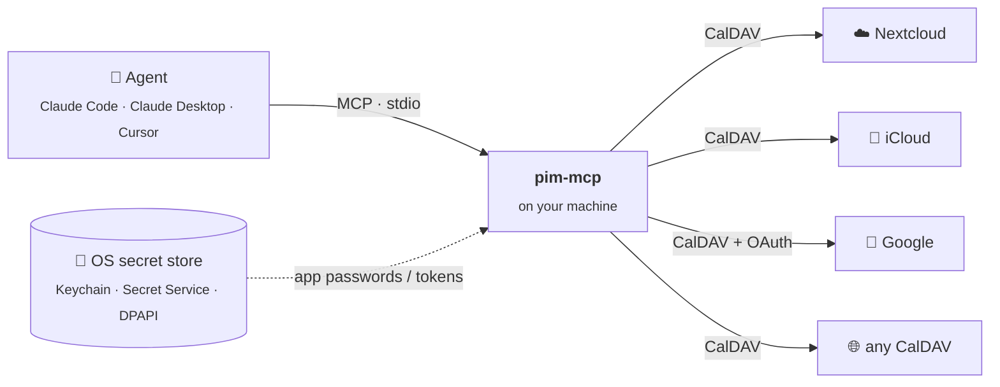

<div align="center">

<picture>
  <source media="(prefers-color-scheme: dark)" srcset="https://raw.githubusercontent.com/da-the-dev/pim-mcp/main/assets/banner-dark.svg">
  
</picture>

<br>

**One thin, local MCP server for all your calendars.**<br>
Nextcloud · iCloud · Google · any CalDAV, merged into a single view your agent can read and manage.

<br>

[](https://www.npmjs.com/package/pim-mcp)
[](https://github.com/da-the-dev/pim-mcp/actions/workflows/ci.yml)
[](https://registry.modelcontextprotocol.io/v0.1/servers?search=io.github.da-the-dev/pim-mcp)
[](https://nodejs.org)
[](#-secrets)
[](LICENSE)

[Quick start](#-quick-start) · [Accounts](#-accounts) · [Connect](#-connect-your-agent) · [Tools](#-tools) · [Guardrails](#%EF%B8%8F-guardrails) · [Providers](#-providers) · [Contributing](#-contributing)

</div>

<br>

```text
 you   › Find me an hour on Thursday afternoon and put the dentist there.

 agent › find_free_time  start=Thu 12:00  end=Thu 18:00  duration_minutes=60
         ↳ 13:00–15:30 · 16:15–18:00
       › create_event    calendar="icloud/personal"  title="Dentist"  start=Thu 13:00
         ↳ ✓ created  Thu 13:00–14:00  · icloud/personal

         Done. Thursday 13:00 is booked; you're free again from 14:00.
```

## ✨ Why

<table>
<tr>
<td width="50%" valign="top">

**🗂️ One merged view**<br>
Every calendar on every account in one sorted list, with recurring events expanded. No more "which account was that in?"

</td>
<td width="50%" valign="top">

**🧳 Portable**<br>
One TOML file with **no secrets in it**. Secrets are references to your OS secret store, env vars or a password manager, so the same config works on every machine.

</td>
</tr>
<tr>
<td valign="top">

**🪶 Thin and local**<br>
Your agent client starts it over stdio when needed. Nothing runs in the background, there's no port open, and no cloud sits in between.

</td>
<td valign="top">

**🛡️ Safe by default**<br>
Deleting events and anything that emails other people stay off until you allow them. Edits never overwrite changes made elsewhere.

</td>
</tr>
</table>

## 🧭 How it works



## 🚀 Quick start

> Requires [Node.js](https://nodejs.org) 22+.

```sh
npm install -g pim-mcp                         # 1 · install (or prefix commands with `npx -y`)
pim-mcp init                                   # 2 · write ~/.config/pim-mcp/config.toml
pim-mcp secret set pim-mcp/icloud              # 3 · store an app password (prompted, not echoed)
pim-mcp check                                  # 4 · verify every account
claude mcp add pim -s user -- npx -y pim-mcp   # 5 · connect your agent
```

`pim-mcp check` lists what it found:

```text
✓ nextcloud (nextcloud) — 3 calendar(s)
    nextcloud/personal               Personal
    nextcloud/work                   Work
✓ icloud (icloud) — 2 calendar(s)
    icloud/family                    Family
    icloud/travel                    Travel
```

The config lives at `~/.config/pim-mcp/config.toml` on every OS (`C:\Users\<you>\.config\pim-mcp\config.toml` on Windows). Set `PIM_MCP_CONFIG` to use another path.

## 🔐 Secrets

Passwords and tokens never go in the config. It holds a **reference** instead:

| Reference | Resolves to |
|---|---|
| `keychain:service/account` | your OS secret store. Easiest: `pim-mcp secret set service/account` |
| `env:NAME` | an environment variable |
| `cmd:<command>` | a command's output, e.g. `cmd:op read op://Private/iCloud/password`, `cmd:pass show icloud`, `cmd:bw get password icloud` |

<details>
<summary><b>🍎 macOS</b>: login Keychain</summary>
<br>

Stored as generic passwords in your login **Keychain**. You can also manage them in Keychain Access, or with `security add-generic-password -s pim-mcp -a icloud -w`.

</details>

<details>
<summary><b>🐧 Linux</b>: Secret Service (GNOME Keyring / KWallet)</summary>
<br>

Needs `secret-tool`:

```sh
sudo apt install libsecret-tools     # Debian / Ubuntu
sudo dnf install libsecret           # Fedora
sudo pacman -S libsecret             # Arch
```

On a **headless machine** there's usually no keyring running. Use `env:` refs (set them in your MCP client's `env` block) or [`pass`](https://www.passwordstore.org/):

```toml
password = "cmd:pass show pim-mcp/icloud"
```

</details>

<details>
<summary><b>🪟 Windows</b>: DPAPI</summary>
<br>

Secrets are encrypted with **DPAPI**, the per-user encryption Credential Manager also uses. They're stored under `%APPDATA%\pim-mcp\secrets\`, and only your Windows user on this machine can decrypt them. Nothing to install. `cmd:` refs run in `cmd.exe`.

</details>

## 👤 Accounts

<details open>
<summary><b>☁️ Nextcloud</b> (any Nextcloud / ownCloud server)</summary>
<br>

1. Nextcloud → **Settings → Security → Devices & sessions → Create new app password**
2. `pim-mcp secret set pim-mcp/nextcloud`

```toml
[[accounts]]
id = "nextcloud"
provider = "nextcloud"
url = "https://your.next.cloud/remote.php/dav"
username = "your-login"
password = "keychain:pim-mcp/nextcloud"
```

</details>

<details open>
<summary><b>🍎 iCloud</b></summary>
<br>

1. [account.apple.com](https://account.apple.com) → **Sign-In and Security → App-Specific Passwords**
2. `pim-mcp secret set pim-mcp/icloud`

```toml
[[accounts]]
id = "icloud"
provider = "icloud"
username = "you@icloud.com"   # the email you sign into your Apple Account with
password = "keychain:pim-mcp/icloud"
```

</details>

<details>
<summary><b>📅 Google</b> (one-time OAuth setup)</summary>
<br>

Google only allows OAuth for CalDAV:

1. [Google Cloud Console](https://console.cloud.google.com): create a project and enable the **CalDAV API**.
2. **OAuth consent screen**: choose External and add yourself as a test user. Then set the publishing status to **In production**, because tokens issued in "Testing" mode expire after 7 days. An "unverified app" warning at sign-in is expected for a personal app.
3. **Credentials → Create OAuth client ID → Desktop app.** Put the client ID in the config and store the secret: `pim-mcp secret set pim-mcp/google-client-secret`
4. `pim-mcp auth google --account google` opens your browser and stores the refresh token in your OS secret store.

```toml
[[accounts]]
id = "google"
provider = "google"
username = "you@gmail.com"
client_id = "xxxx.apps.googleusercontent.com"
client_secret = "keychain:pim-mcp/google-client-secret"
refresh_token = "keychain:pim-mcp/google"
```

</details>

<details>
<summary><b>🌐 Any other CalDAV server</b></summary>
<br>

```toml
[[accounts]]
id = "fastmail"
provider = "caldav"
url = "https://caldav.fastmail.com/"
username = "you@fastmail.com"
password = "keychain:pim-mcp/fastmail"
```

Known URLs are in [Providers](#-providers).

</details>

## 🔌 Connect your agent

**Claude Code** (any OS)

```sh
claude mcp add pim -s user -- npx -y pim-mcp
```

**Claude Desktop, Cursor and other GUI clients.** Add this to the client's MCP config:

<details open>
<summary><b>🍎 macOS</b>: <code>~/Library/Application Support/Claude/claude_desktop_config.json</code></summary>
<br>

```json
{
  "mcpServers": {
    "pim": { "command": "npx", "args": ["-y", "pim-mcp"] }
  }
}
```

GUI apps don't always see your shell's PATH. If the server fails to start, replace `npx` with the full path from `which npx`, e.g. `/opt/homebrew/bin/npx`.

</details>

<details>
<summary><b>🪟 Windows</b>: <code>%APPDATA%\Claude\claude_desktop_config.json</code></summary>
<br>

```json
{
  "mcpServers": {
    "pim": { "command": "cmd", "args": ["/c", "npx", "-y", "pim-mcp"] }
  }
}
```

`npx` is a batch script on Windows, so it runs through `cmd /c`.

</details>

<details>
<summary><b>🐧 Linux</b></summary>
<br>

Claude Desktop isn't available for Linux; use Claude Code or another MCP client with the same `command` / `args` as macOS. `env:` refs go in the client's `env` block:

```json
"pim": {
  "command": "npx",
  "args": ["-y", "pim-mcp"],
  "env": { "ICLOUD_PASSWORD": "…" }
}
```

</details>

## 🧰 Tools

| | Tool | What it does |
|:-:|---|---|
| 📚 | `list_calendars` | All calendars and their ids (`icloud/work`). Anywhere a tool takes a calendar, a plain name works too. |
| 🗓️ | `list_events` | Events from all calendars in a range, merged and sorted. Defaults to today through the next 7 days. |
| 🔎 | `search_events` | Text search over title, location and description. |
| 📄 | `get_event` | Full details: description, attendees, organizer, recurrence rule. |
| 🕐 | `find_free_time` | Free windows of at least N minutes, optionally within working hours. |
| ➕ | `create_event` | Timed or all-day, with recurrence, a reminder, and busy/free status. |
| ✏️ | `update_event` | Changes only the fields you pass. Recurring events take `scope`: `instance` or `series`. |
| 🗑️ | `delete_event` | Off unless `allow_delete = true`. |

What agents see:
- Times without an offset are in your configured `timezone`.
- Output is ISO 8601 with offsets.
- All-day events use `YYYY-MM-DD`, and their end date is inclusive.

## 🛡️ Guardrails

```toml
timezone = "Europe/Amsterdam"            # default: the system timezone

[guardrails]
allow_delete  = false                    # delete_event is refused
allow_invites = false                    # no adding attendees, no editing/deleting events that have them

[[accounts]]
# …
read_only           = true               # no writes to this account at all
read_only_calendars = ["Family"]         # protect specific calendars
hide_calendars      = ["Birthdays"]      # don't show these at all
```

- **Refusals explain themselves.** When a guardrail blocks something, the agent is told which setting would allow it, so it asks you instead of retrying.
- **No lost edits.** Every write checks the event's ETag. If the event changed elsewhere since it was read, the write fails instead of overwriting.

## 🌍 Providers

| Provider | Status | Setup |
|---|:-:|---|
| Nextcloud / ownCloud | ✅&nbsp;tested | `nextcloud` · `https://<host>/remote.php/dav` |
| iCloud | ✅&nbsp;tested | `icloud` · app-specific password |
| Google Calendar | 🧪&nbsp;beta | `google` · OAuth. Not yet tried with a real account; [reports welcome](https://github.com/da-the-dev/pim-mcp/issues) |
| Fastmail | 🟡&nbsp;untested | `caldav` · `https://caldav.fastmail.com/` |
| Yahoo | 🟡&nbsp;untested | `caldav` · `https://caldav.calendar.yahoo.com` |
| mailbox.org | 🟡&nbsp;untested | `caldav` · `https://dav.mailbox.org/` |
| Posteo | 🟡&nbsp;untested | `caldav` · `https://posteo.de:8443/` |
| Radicale · Baïkal · SOGo · Synology | 🟡&nbsp;untested | `caldav` · your server's DAV URL |
| Outlook · Microsoft 365 · Exchange | 🚧&nbsp;wanted | no CalDAV; needs a [Microsoft Graph backend](CONTRIBUTING.md#adding-a-non-caldav-backend-eg-outlook) |
| Proton Calendar | ❌&nbsp;n/a | no CalDAV or public API |

🟡 **untested** means standard CalDAV that should just work but hasn't been confirmed with pim-mcp yet. Tried one? A PR updating this table is very welcome.

## 🗺️ Roadmap

- [x] Calendars over CalDAV: Nextcloud, iCloud, Google, generic
- [x] macOS · Linux · Windows secret stores
- [ ] Outlook / Microsoft 365 via Microsoft Graph
- [ ] Mail: IMAP / SMTP, same accounts and config
- [ ] Files: WebDAV (Nextcloud, …)

## 🤝 Contributing

New providers, bug fixes and "it works with X" confirmations are all welcome. See **[CONTRIBUTING.md](CONTRIBUTING.md)** for dev setup, a throwaway local CalDAV server for testing, and how to add a provider.

<div align="center">
<br>
<sub>MIT © Aleksey Tkachenko · built for agents, readable by humans</sub>
</div>
